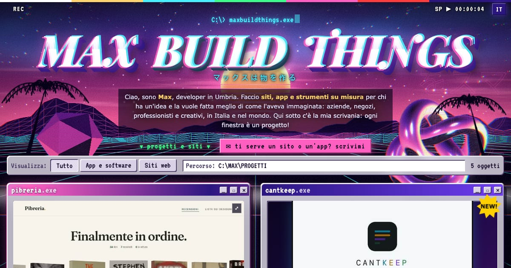

# maxbuildthings

Il sito vetrina di Max, developer in Umbria: un desktop finto in stile Windows 98, con l'estetica vaporwave di fine anni '90 e una finestra per ogni progetto.

**→ [maxbuildthings.vercel.app](https://maxbuildthings.vercel.app)**



## Cosa c'è dentro
- Una pagina sola (`index.html`), con CSS, JS e screenshot tutti dentro. Niente framework e niente build.
- Una scena WebGL fatta con Three.js r128: cielo con l'aurora, sole a strisce, montagne al neon, oggetti cromati, bloom e un velo VHS. Scorrendo, la griglia accelera e il sole scende.
- Finestre di vetro che si trascinano, si arrotolano e si chiudono, uno screensaver con tre modi, e tutto il sito in italiano e in inglese.
- Una sezione Prodotti con le cose che vendo: app, libri, agende e strumenti.
- Nessuna richiesta a domini terzi, quindi niente cookie e niente tracker: font e librerie li serve il sito stesso, e la CSP in `vercel.json` lo garantisce.

## Provarlo in locale
```
cd strumenti && npm install && cd ..
node strumenti/serve.mjs        # http://localhost:5182, con le stesse intestazioni di Vercel
node strumenti/controlla.mjs    # controlla errori, domini terzi, font, scena 3D, traduzioni e 404
```

## Contatti
massi.cc@proton.me: rispondo io, non un modulo.

## In English
The portfolio of Max, a developer in Umbria, Italy: a fake Windows 98 desktop with a '90s vaporwave look and one window per project. A single `index.html` with no framework and no build step, a Three.js WebGL scene (aurora sky, striped sun, neon mountains, chrome objects, bloom, a light VHS pass), draggable glass windows, Italian and English, and zero third-party requests. English version: [maxbuildthings.vercel.app/?lang=en](https://maxbuildthings.vercel.app/?lang=en).
